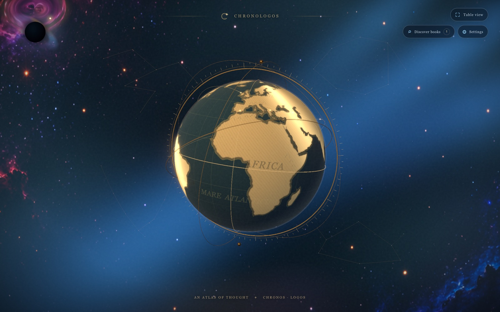
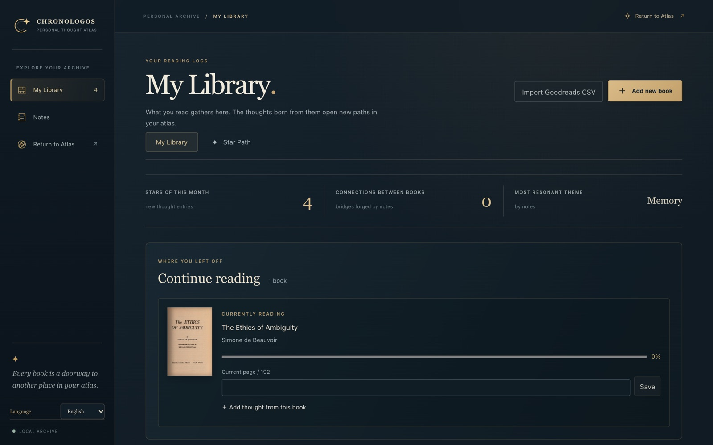
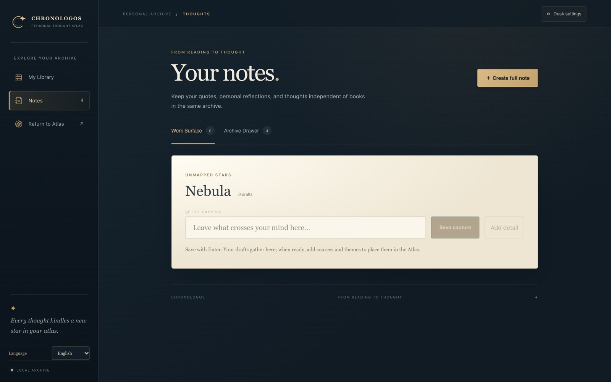

# Chronologos

**A personal thought atlas.** Chronologos turns the quotes and ideas you collect while reading into a living 3D night sky: every note becomes a star, and the connections you draw between notes become constellations.

Instead of counting finished books, it keeps what remains of them — thoughts, sources and the relationships between ideas — in a local archive that never leaves your machine.



| Library | Notes |
| --- | --- |
|  |  |

## Product loop

**Add a book → capture a quote or thought → find its star in the Atlas → connect it to other thoughts → rediscover an old idea.**

## Views

- **Atlas (`/`, `/atlas`)** — A full-screen, slowly moving 3D scene. The antique-style globe (*Chronos*) represents the historical and geographic roots of ideas; the stars around it (*Logos*) are your notes. A black-hole portal leads to the archive. Designed to stay open quietly on a second screen.
- **Library (`/library`)** — Shelves and cover views, Goodreads CSV import, Open Library work/edition lookup, reading status and progress, a yearly goal shown as an interactive 3D astrolabe, and a reading timeline.
- **Notes (`/notes`)** — A workbench that keeps the author's quote, your own commentary and the source (book, edition, page) separate. Quick drafts ("Nebula") stay out of the Atlas until you place them.

The interface is available in **English, German and Turkish**; personal content is never translated.

## Features

- **Persistent stars.** Each note gets a stable position in the sky. Adding new notes never moves existing stars.
- **Typed connections.** Link notes as *supports*, *challenges*, *extends*, *echoes* or *contrasts*, with an optional rationale. Keyboard and touch work without drag-and-drop.
- **Reading Astrolabe.** The yearly goal is rendered as a React Three Fiber scene: finished books glow as stars ordered by completion date, books in progress orbit outside the goal.
- **Author compass.** Store where a story is set or where it was written, with source and confidence; markers cluster on the globe.
- **Resonance instead of ratings.** Optional tags (*Transformative*, *Keystone*, *Thought-provoking*, *Catalyst*) replace five-star ratings; legacy ratings are preserved.
- **Forgotten star of the day.** Resurfaces a note you have not deliberately opened for at least six months.
- **Optional local AI.** On request, a local [Ollama](https://ollama.com) model suggests up to three connection candidates. Nothing is saved automatically, and note text never leaves the device.
- **Export.** Versioned JSON export of the whole archive (schema 8).
- **Accessibility.** Keyboard navigation, focus management, `prefers-reduced-motion` support and a static fallback when WebGL is unavailable.

## Tech stack

| Area | Technology |
| --- | --- |
| UI | React 18, Vite, Tailwind CSS 4 |
| 3D | Three.js, React Three Fiber, Drei, postprocessing (bloom) |
| Maps | d3-geo, topojson, world-atlas |
| API | Node.js HTTP server |
| Storage | SQLite via `node:sqlite`, versioned SQL migrations |
| Desktop | Electron, electron-builder (Windows installer) |
| AI (optional) | Ollama on `127.0.0.1:11434` |

```
React views ──► /api (local Node server) ──► SQLite
                     │
                     └─► Ollama (optional, local only)
```

The Electron shell starts the API in its own Node utility process; the UI talks to it over the same local origin, so the backend stays independent of the desktop wrapper.

## Getting started

Requires **Node.js 24.14 or newer** (see `.node-version`).

```bash
npm ci
npm run db:seed   # optional: four demo books and four sample notes
npm run dev
```

Open the URL Vite prints (usually `http://localhost:5173`). The API runs on `127.0.0.1:4178`; use `API_PORT=4179 npm run dev` if the port is taken.

| Command | Purpose |
| --- | --- |
| `npm run dev:api` / `npm run dev:ui` | Run API and UI separately |
| `npm run build` / `npm run preview` | Production build and preview |
| `npm run desktop:dev` | Open the Electron window |
| `npm run desktop:installer` | Build the Windows installer into `release/` |

### Optional: local AI suggestions

```bash
ollama pull qwen3-embedding:0.6b
ollama pull qwen3:0.6b
```

Models can be changed with `CHRONOLOGOS_EMBED_MODEL` and `CHRONOLOGOS_CHAT_MODEL`. Without Ollama, theme and concept matching still works.

## Checks

```bash
node scripts/atlas-geometry-check.mjs      # star layout performance (10,000 notes)
node scripts/i18n-core-check.mjs           # localization core
node scripts/link-cue-check.mjs            # connection cue geometry
node scripts/portal-transition-check.mjs   # archive navigation and portal transition
```

`node scripts/i18n-audit.mjs` reports missing, conflicting and untranslated strings.

## Data and privacy

- All data — books, progress, goals, places, notes, drafts and connections — lives in a local SQLite database. Development uses `server/data/chronologos.sqlite` (git-ignored); the installed app uses `%APPDATA%\Chronologos\chronologos.sqlite`, separate from the install folder.
- Only an ISBN or title is sent to Open Library when you search the catalog; notes and commentary are never sent.
- Close the app before copying the database file (it runs in WAL mode).

## Project structure

```
src/
  scene/        Atlas: globe (Chronos), stars and links (Logos), portal, performance
  library/      Library, notes, reading timeline and astrolabe
  navigation/   Portal and note transitions
  i18n/         Language selector and EN/DE/TR dictionaries
server/
  migrations/   SQLite schema versions (001–011)
  index.js      Local HTTP API
  thoughts.js   Note and Atlas rules
  seed.js       Repeatable demo data
electron/       Desktop shell
scripts/        Dev runner and checks
```

## Status and limitations

Version 0.1.7. Chronologos is a single-user, local application. It has no authentication or multi-user authorization yet, and JSON import/restore is not implemented. These would need to be in place before exposing it to the internet.
